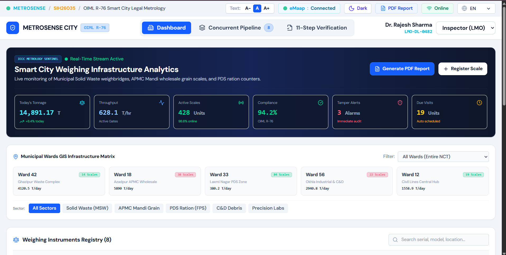
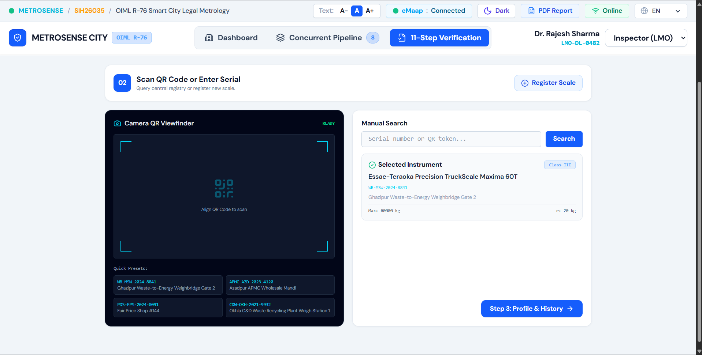
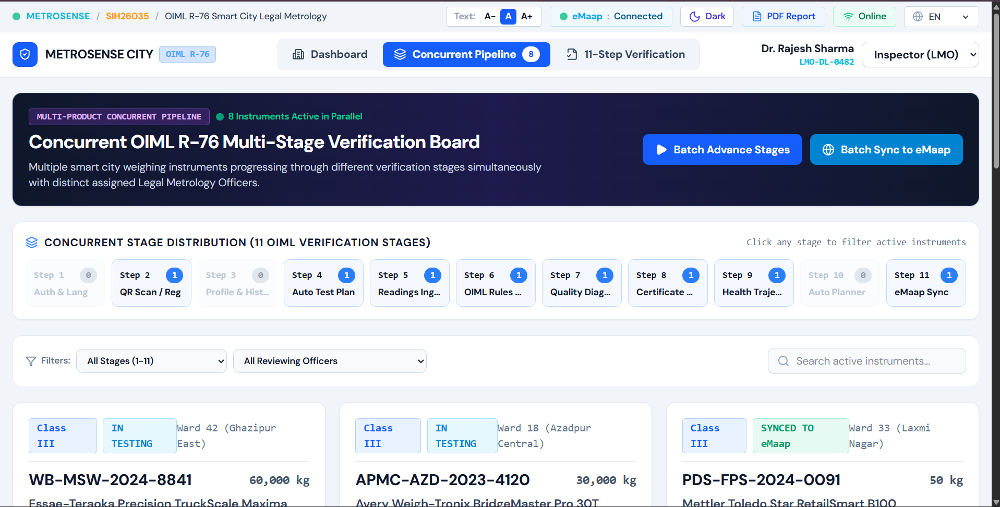

# MetroSense City — Team Omnicraft

> A multilingual, OIML R-76 rule-driven digital platform for testing, verifying,
> reporting, and monitoring Non-Automatic Weighing Instruments.

MetroSense City is a Legal Metrology solution developed for **Smart India Hackathon
2026 — SIH26035**. It digitizes the testing and report-generation workflow for
Non-Automatic Weighing Instruments (NAWIs), including electronic scales, platform
scales, and weighbridges.

The platform replaces paper-based test sheets, manual calculations, fragmented
spreadsheets, and difficult-to-retrieve reports with a secure, standardized, and
traceable digital workflow.

---

## Problem Statement

Legal Metrology Officers and testing laboratories often manage test observations,
calculations, reports, and verification history through manual or disconnected systems.
This can lead to calculation mistakes, inconsistent report formats, missing historical
records, slow approvals, and weak auditability.

MetroSense City addresses **SIH26035** by providing a software platform for generating
test reports for NAWIs according to **OIML R-76**.

---

## Solution

MetroSense City enables users to:

1. Register weighing instruments and maintain complete asset details.
2. Record test observations digitally during inspection or laboratory testing.
3. Automatically calculate measurement error and compare it with permissible limits.
4. Generate a clear **Pass**, **Fail**, or **Review Required** outcome.
5. Create standardized PDF test reports with report ID and QR verification.
6. Store searchable instrument, test, scan, report, and compliance history.
7. Maintain immutable audit trails and version-controlled corrections.
8. Track due verification visits, compliance trends, and inspector workload.

```text
Instrument Registration
        ↓
Digital Test Observation
        ↓
OIML R-76 Calculation
        ↓
Review and Approval
        ↓
PDF Report + QR Verification
        ↓
Immutable Audit History
        ↓
Due-Visit Scheduling and Analytics
```

---

## Key Features

| Feature | Description |
|---|---|
| OIML R-76 Test Workflow | Guided digital workflow for entering test observations and verification data |
| Automated Compliance Check | Calculates error and compares it with applicable permissible error limits |
| Standardized PDF Reports | Generates structured, downloadable inspection and test reports |
| QR Report Verification | Enables quick validation of report ID, status, version, and authenticity |
| Immutable Audit Trail | Stores every important action, correction, approval, timestamp, and user identity |
| Controlled Editing | Drafts can be edited; approved reports are versioned rather than overwritten |
| Searchable History | Retrieves previous instruments, scans, test reports, evidence, and compliance records |
| Multilingual Interface | Supports field officers and stakeholders in multiple languages |
| Role-Based Access | Provides separate permissions for technicians, inspectors, reviewers, approvers, and auditors |
| Due-Visit Alerts | Identifies instruments requiring verification, reinspection, or follow-up |
| Analytics Dashboard | Shows compliance, active scales, pending reports, alerts, and verification status |
| Smart-City Roadmap | Future GIS, IoT, tamper-alert, and connected-scale monitoring support |

---

## OIML R-76 Calculation Logic

MetroSense City calculates measurement error using:

\[
E = I - L
\]

Where:

- `E` = Measurement error
- `I` = Instrument-indicated value
- `L` = Applied reference load


The result is generated through a deterministic rules engine. AI can assist with OCR,
search, or anomaly detection, but the final compliance outcome is based on validated
rules and authorized officer approval.

---

## 🛠️ Technology Stack

| Layer | Technologies |
|---|---|
| Frontend | React, Tailwind CSS, JavaScript |
| Backend | FastAPI, Python |
| Database | PostgreSQL, SQLAlchemy |
| Authentication | JWT, OAuth 2.0 |
| Reports | ReportLab, QR Code Generation |
| AI & Computer Vision | OpenCV, MediaPipe, Google Gemini |
| Deployment | Vercel, Render |

---

## 📸 Screenshots

### 1. Dashboard


### 2. Instrument Scanning


### 3. Concurrent Inspection Pipeline


### 4. 11-Step Verification


---

## 🌐 Live Demo

Explore the MetroSense City MVP:

[**Launch MetroSense City**](https://metrosence-city.vercel.app/)

---

## Demo Workflow

1. Register a weighing instrument.
2. Enter OIML R-76 test observations.
3. Automatically calculate error and compliance status.
4. Submit the test for review.
5. Approve the report using an authorized role.
6. Generate a QR-enabled PDF report.
7. Verify the report through its QR code or report ID.
8. View the complete audit trail and version history.
9. Monitor pending verification visits through the dashboard.

---

## Project Status

🚧 **Active Development** — Smart India Hackathon 2026 prototype.

---

## Security and Data Integrity

- No secrets, API keys, or real user data are stored in the repository.
- Approved reports cannot be silently edited or deleted.
- Every correction creates a traceable version.
- Audit trails preserve user actions, timestamps, reasons, and approval history.
- Final reports can be protected with integrity hashes and QR-based verification.

---

## Future Scope

- Offline mobile inspection workflow.
- Hindi and additional Indian-language support.
- GIS-based ward and district analytics.
- Automated verification and calibration reminders.
- IoT-connected scales and weighbridges.
- Tamper-event monitoring.
- OCR extraction from paper forms and certificates.
- AI-assisted anomaly detection and report search.


